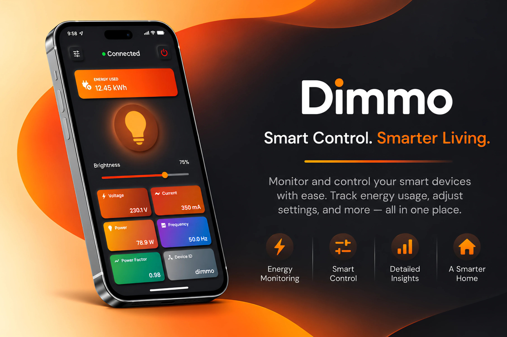

<!-- Gradient Divider -->


<!-- App Preview Banner -->
<p align="center">
  
</p>

<!-- Title -->
<p align="center">
  <b>TRIAC Firing Angle Control – Closed Loop Ecosystem (v3.0)</b>
  <br> <small> <i>- A precision-engineered AC power modulation system featuring real-time telemetry, secure IoT networking, and hardware-level safety mechanisms -</i> </small> <br>
</p> 

<!-- Badges -->
<p align="center">
  <a href="https://github.com/Nariman-Z/Dimmo/releases"></a>
  <a href="https://github.com/Nariman-Z/Dimmo/actions/workflows/release-apk.yml"></a>
  <a href="LICENSE"></a>
  <a href="docs/pdf/BSc_Thesis_Nariman_Ziaie.pdf"></a>
  <a href="CONTRIBUTING.md"></a>
</p>
<p align="center">
  <a href="https://www.espressif.com/"></a>
  <a href="https://platformio.org/"></a>
  <a href="firmware/"></a>
  <a href="flutter_app/"></a>
  <a href="flutter_app/"></a>
  <a href="docs/architecture/mqtt_architecture.md"></a>
  <a href="tools/"></a>
</p>

---

## 📌 Project Status

> [!NOTE]
> **Dimmo IoT Smart Dimmer Ecosystem (v3.0.0)**  
> This repository contains the complete open-source Dimmo ecosystem, including ESP32 hardware firmware, cross-platform Flutter mobile application, Python hardware simulation suite, PCB schematics, and comprehensive architectural documentation.

---

## 🎓 Academic Project & B.Sc. Thesis

Dimmo was originally developed as an Electrical Engineering Bachelor's Degree Graduation Project by **Nariman Ziaie**.

📄 **[Download / View Official B.Sc. Thesis (PDF)](docs/pdf/BSc_Thesis_Nariman_Ziaie.pdf)**  
*Contains complete undergraduate research findings, phase-angle dimming mathematical models, zero-crossing detection circuit topology, and IoT system integration.*

---

## 🔧 Introduction
Project Dimmo is a high-performance, microcontroller-driven **closed-loop TRIAC control system** engineered for deterministic AC voltage regulation. The platform seamlessly unifies real-time edge telemetry with encrypted remote cloud communication, featuring:
- **True RMS Edge Feedback:** High-fidelity, continuous AC mains voltage and current telemetry.
- **Hardened IoT Architecture:** Secure remote orchestration over network boundaries via MQTT encapsulated in TLS 1.2.
- **Deterministic Power Management:** Dynamic adjustment to load profiles and environmental fluctuations spanning $0^\circ \text{ to } 180^\circ$ phase bounds.
- **Fail-Safe Safety Topologies:** Layered hardware and software safeguards protecting against transient faults and buffer overflow conditions.
- **Cross-Platform Mobile Integration:** Real-time mobile dashboard with neumorphic UI and multilingual localization built with Flutter.

Ideally suited for industrial heating elements, precision lighting dimming systems, and inductive motor speed modulation.

---

## ⚙️ Hardware Components
| Component               | Functional Overview                                                           |
|-------------------------|-------------------------------------------------------------------------------|
| **ESP32-WROOM**         | Dual-core compute engine handling asynchronous control loops, telemetry, and TLS execution. |
| **H11AA1**              | Dual-optoisolated zero-cross detection circuit utilizing hardware RC noise filtration. |
| **BTA16 + MOC3021**     | Snubber-protected, optically isolated high-power AC semiconductor switching node.    |
| **ZMPT101B**            | Precision voltage transformer module for analog true RMS mains monitoring (0-250V AC). |
| **ACS712**              | Hall-effect linear current sensor for line-load telemetry tracking.             |
| **16x2 I2C LCD**        | Low-latency visual instrumentation panel displaying systemic edge parameters.      |

---

## 💻 Software Architecture
Implemented via a high-efficiency **C++ (PlatformIO / Arduino-ESP32 Core)** framework alongside a companion **Flutter** mobile client and **Python** hardware simulator:

### Core Execution Modules
- **Hardware-Driven Zero-Cross Interception**  
  Interrupt-driven (ISR) detection engine coupled with dynamic software debouncing algorithms to neutralize harmonic line noise.
- **Adaptive Frequency Calibration**  
  Auto-sensing logic capable of hot-swapping timing parameters between 50Hz and 60Hz mains environments.
- **Microsecond-Resolution Pulse Timing**  
  Hardware timer group allocation providing fine-grained firing angle calibration spanning $0^\circ \text{ to } 180^\circ$ phase bounds.
- **Non-Blocking Telemetry Pipelines**  
  Concurrent analog sampling arrays processing raw inputs from the ZMPT101B and ACS712 sensors into reliable Root-Mean-Square (RMS) metrics.

### Distributed Network Engine
- **Encrypted Transport Layer**  
  TLS 1.2 authenticated session layer mapping command-and-control operations safely over port `8883`.
- **Protected OTA Deployments**  
  Password-authenticated, dual-partition Over-The-Air firmware updater accessible over local management interfaces.
- **Network Time Synchronization**  
  NTP client abstraction layers ensuring sub-millisecond timestamp consistency for edge logging.
- **Runtime Integrity & Heap Sanity**  
  Continuous memory pool inspection with proactive stack boundaries to clear structural leakage before reaching buffer starvation thresholds.

### Mobile & Simulator Ecosystem
- **Neumorphic Flutter App**  
  Cross-platform dashboard supporting real-time control, metrics visualization, status indicators, and multilingual support.
- **Python Hardware Simulator**  
  Complete offline testing suite mirroring the ESP32 MQTT JSON protocol for rapid development without physical hardware.

> 🔐 Edge-to-Cloud telemetry transport routes over an enterprise-hardened [EMQX](https://www.emqx.com/) broker engine.  
> 📚 See the official [EMQX Clustering & Security Documentation](https://docs.emqx.com/) for TLS certificate configuration.

---

## 🚀 Key Features
| Operational Vector | Functional Characteristics |
|------------------|--------------------------------------------------------------------------|
| **Phase Modulation** | Deterministic ZC polling • Microsecond firing precision • Dual-frequency normalization |
| **Instrumentation**| Dynamic Volt/Amp conversion engines • True-RMS estimation • Asynchronous LCD raster updates |
| **Networking**   | Asynchronous MQTT clients • TLS encrypted backhaul • Password-gated OTA partitions |
| **Mobile App**   | Cross-platform Flutter dashboard • Neumorphic design • Real-time telemetry charts |
| **Simulation**   | Python hardware simulator • Full MQTT JSON protocol emulation • Configurable test fixtures |
| **Resilience**   | Hardware watchdog timers • Monitored heap blocks • Galvanic signal decoupling • Panic-stop routines |

---

## 🌐 Remote Access Topography
| Sub-System | Binding Port / Bus | Operational Scope | Security Paradigm |
| :--- | :--- | :--- | :--- |
| **MQTT over TLS** | `8883` | Remote Command, Telemetry, and Device Control | TLS 1.2 Encryption & Digest Authentication |
| **Arduino OTA** | `8266` | Over-The-Air Firmware Image Flashing | Password Protected & Reboot Validation |
| **NTP Client** | `123` (UDP) | Real-Time Clock Synchronization | Public NTP Time Pool |
| **USB Serial** | 115200 Baud | High-Speed Instrumentation & Logging | Direct Hardware UART |

---

## 🛡️ Defect Isolation & Safety Controls
- **Independent Hardware Watchdog (WDT):** Automates compute recovery by forcing hard reboots upon execution stalling.
- **Memory Boundary Defense:** Constantly monitors runtime allocation fragmentation, executing soft-resets prior to fatal heap exhaustion.
- **Asynchronous Emergency Kill-Switch:** Instantaneous absolute power decoupling available via all local and networked vectors.
- **Atomic Critical Path Protections:** Isolate execution counters within memory-safe barriers to avoid variable corruption during rapid ISR fires.
- **Galvanic Boundary Isolation:** Optocoupler arrays decouple low-voltage CMOS logic domains from high-voltage AC execution zones.

---

## 🏗️ Architecture & Repository Structure

### 🔄 System Communication Topology

```text
┌──────────────────────────────────────┐           ┌──────────────────────────────────────┐
│          Flutter Mobile App          │           │       Python Hardware Simulator      │
│     (Real-Time Control & Metrics)    │           │      (Mock Hardware & Testing)       │
└──────────────────┬───────────────────┘           └──────────────────┬───────────────────┘
                   │                                                  │
                   │  TLS 1.2 Encrypted MQTT (Port 8883)              │
                   ▼                                                  ▼
         ┌──────────────────────────────────────────────────────────────────┐
         │                    Cloud / Local MQTT Broker                     │
         │                   (EMQX Message Broker / TLS)                    │
         └─────────────────────────────────┬────────────────────────────────┘
                                           │
                                           │ Telemetry & Commands (JSON)
                                           ▼
                           ┌────────────────────────────────┐
                           │   ESP32 Edge Microcontroller   │
                           │   (PlatformIO C++ Core Engine) │
                           └───────┬────────────────┬───────┘
                                   │                │
                 Zero-Cross ISR    │                │ Microsecond Gate Firing
                 & True RMS Sense  │                │ (Phase Angle: 0° to 180°)
                                   ▼                ▼
          ┌──────────────────────────────┐    ┌──────────────────────────────┐
          │      Sensors & Isolation     │    │      Power Semiconductor     │
          │  • H11AA1 Zero-Crossing      │    │  • MOC3021 Optocoupler       │
          │  • ZMPT101B Voltage (RMS)    │    │  • BTA16-600B Power TRIAC    │
          │  • ACS712 Current (RMS)      │    │  • RC Snubber Filter Network │
          └──────────────────────────────┘    └──────────────┬───────────────┘
                                                             │
                                                             ▼
                                              ┌──────────────────────────────┐
                                              │    AC Mains Load (220V)      │
                                              │  (Incandescent, Heat, Motor) │
                                              └──────────────────────────────┘
```

### 📁 Repository Directory Structure

```text
Dimmo/
├── .github/
│   └── workflows/
│       └── release-apk.yml          # GitHub Actions CI: Automated Flutter release APK build & deploy
├── docs/                            # Comprehensive engineering and architectural documentation
│   ├── architecture/                # System diagrams, MQTT protocol, and security models
│   │   ├── communication_protocol.md# MQTT topics, payload schemas, and QoS levels
│   │   ├── mqtt_architecture.md     # TLS 1.2 encryption, session routing, and authentication
│   │   └── system_architecture.md   # Architectural overview and subsystem decomposition
│   ├── development/                 # Subsystem setup, compilation, and troubleshooting guides
│   │   ├── firmware_setup.md        # ESP32 PlatformIO build, flashing, and configuration
│   │   ├── flutter_setup.md         # Flutter SDK setup, dependencies, and APK generation
│   │   └── troubleshooting.md       # Hardware diagnostic procedures, FAQs, and debugging
│   ├── hardware/                    # Circuit analysis, wiring schematics, and signal waveforms
│   │   ├── components.md            # Complete Bill of Materials (BOM) & component ratings
│   │   ├── datasheets.md            # Hardware datasheet index & academic thesis reference
│   │   ├── hardware_setup.md        # Physical assembly, pin mappings, and sensor calibration
│   │   ├── schematic_notes.md       # Galvanic isolation, snubber network, and gate drive
│   │   └── waveforms.md             # Oscilloscope captures and zero-cross timing analysis
│   ├── images/                      # Signal captures, circuit photos, and visual assets
│   ├── pdf/
│   │   └── BSc_Thesis_Nariman_Ziaie.pdf # Official B.Sc. graduation thesis research paper
│   └── README.md                    # Documentation index and subsystem reference map
├── firmware/                        # ESP32 embedded firmware (PlatformIO / C++)
│   ├── include/                     # Project C++ header declarations
│   ├── lib/
│   │   └── Secrets/                 # Private credentials isolation module
│   │       ├── Secrets.h.example    # Public credentials and TLS CA root template
│   │       └── Secrets.h            # Local Wi-Fi, MQTT credentials, and TLS CA (gitignored)
│   ├── src/
│   │   └── main.cpp                 # Firmware entry: ISR, TRIAC phase control, RMS ADC, TLS MQTT, OTA
│   ├── test/                        # Embedded unit testing suite
│   ├── platformio.ini               # PlatformIO build environments, board profiles, and dependencies
│   └── README.md                    # Firmware documentation, pinout mappings, and flashing guide
├── flutter_app/                     # Cross-platform mobile dashboard application
│   ├── android/                     # Android native platform project and Gradle configurations
│   ├── assets/
│   │   ├── certificates/            # TLS root certificates (client.crt.example)
│   │   └── icon/                    # Multi-resolution application launcher icons
│   ├── ios/                         # iOS native platform project and Xcode workspace
│   ├── lib/                         # Application source code
│   │   ├── core/                    # Theme, constants, network services, and localization (EN/FA)
│   │   ├── features/                # Auth connection screen, real-time dashboard, and telemetry
│   │   └── main.dart                # Application entrypoint and dependency initialization
│   ├── pubspec.yaml                 # Flutter package metadata, dependencies, and assets
│   └── README.md                    # Mobile client setup, features, and build instructions
├── hardware/                        # Hardware design assets, PCB layouts, and datasheets
│   ├── datasheets/                  # Manufacturer datasheets (BTA16, H11AA1, ZMPT101B, ACS712, etc.)
│   ├── pcb/                         # Printed circuit board Gerber and layout files
│   ├── schematics/                  # Circuit schematic source files and diagrams
│   └── README.md                    # Hardware subsystem index and bill of materials links
├── tools/                           # Offline simulation and MQTT verification toolset
│   ├── mqtt/
│   │   ├── samples/                 # Standard JSON sample payloads (command, telemetry, status)
│   │   ├── schemas/                 # Formal JSON Schemas for payload validation
│   │   └── test_mqtt_payloads.py    # Automated offline schema validator & live MQTT test runner
│   ├── scripts/
│   │   ├── config.example.json      # Hardware simulator configuration template
│   │   ├── config.json              # Local simulator configuration (gitignored)
│   │   └── esp_simulator.py         # Python-based ESP32 hardware simulator for offline testing
│   ├── requirements.txt             # Python dependencies (paho-mqtt, jsonschema)
│   └── README.md                    # Simulation toolset guide and verification workflows
├── .editorconfig                    # Cross-editor formatting specifications
├── .gitattributes                   # Git path-specific attributes and line-ending rules
├── .gitignore                       # Repository-wide build and secret exclusion patterns
├── CHANGELOG.md                     # Semantic version release notes and project history
├── CONTRIBUTING.md                  # Development guidelines, PR workflow, and standards
├── DISCLAIMER.md                    # High-voltage electrical safety warnings and legal terms
├── LICENSE                          # MIT Open-Source License
├── README.md                        # Master project documentation and ecosystem overview
└── SECURITY.md                      # Vulnerability reporting protocol and secrets hygiene
```

### 📦 Key Subsystems & Navigation

- ⚡ **[`firmware/`](firmware/)**: PlatformIO C++ firmware targeting the ESP32-WROOM-32. Handles interrupt-driven zero-crossing detection, microsecond-precision TRIAC gate firing ($0^\circ \text{ to } 180^\circ$), continuous true-RMS voltage/current sampling, over-the-air (OTA) updates, and encrypted TLS 1.2 MQTT telemetry.
- 📱 **[`flutter_app/`](flutter_app/)**: Production-ready cross-platform mobile application (`com.narimanz.dimmo`) built with Flutter & Dart. Features a neumorphic UI, real-time electrical metrics (V, I, W, Hz, kWh, PF), debounced brightness slider, dark/light themes, and bilingual support (English/Persian).
- 🔌 **[`hardware/`](hardware/)**: Electrical design assets including component datasheets (BTA16 TRIAC, H11AA1 zero-cross detector, ZMPT101B voltage transformer, ACS712 Hall-effect sensor), circuit schematics, PCB layouts, and optoisolation safety boundaries.
- 🧪 **[`tools/`](tools/)**: Complete offline development suite featuring a Python ESP32 hardware simulator (`esp_simulator.py`), official JSON payload schemas, sample payloads, and an automated schema verification runner (`test_mqtt_payloads.py`).
- 📚 **[`docs/`](docs/)**: In-depth documentation suite containing system architecture, TLS 1.2 MQTT network specifications, step-by-step setup guides, oscilloscope waveform captures, and the original undergraduate research B.Sc. thesis PDF.
- 🤖 **[`.github/workflows/`](.github/workflows/)**: Automated CI/CD pipeline (`release-apk.yml`) that builds and packages signed release Android APKs on GitHub release tag pushes (`v*`).

---

## 🛠️ Development Setup

Quick links to setup instructions for each component:

- ⚡ **[Firmware Setup Guide](docs/development/firmware_setup.md)**: PlatformIO environment, dependencies, flashing, and configuration.
- 📱 **[Flutter Setup Guide](docs/development/flutter_setup.md)**: Flutter SDK prerequisites, pub dependencies, build & run instructions.
- 🧪 **[Tools & Simulator Guide](docs/development/troubleshooting.md)**: Python MQTT hardware simulator setup and testing workflows.
- 🎓 **[Academic B.Sc. Thesis (PDF)](docs/pdf/BSc_Thesis_Nariman_Ziaie.pdf)**: Complete undergraduate research paper by Nariman Ziaie.
- 📑 **[Datasheets & Waveforms](docs/hardware/datasheets.md)**: Component datasheets, oscilloscope signal captures, and circuit analysis.
- 🔐 **[Secrets & Configuration Setup](SECURITY.md#secrets-management--configuration-guidelines)**: Generating local configuration files (`Secrets.h` and `config.json`).
- 📜 **[Changelog & Version History](CHANGELOG.md)**: Track all release notes, historical milestones, and version updates across project iterations.

---

## 🤝 Contributing

Contributions are welcome and greatly appreciated! Whether you're fixing bugs, improving documentation, optimizing the control algorithms, or proposing new features, your help makes **Dimmo** better.

### Ways to Contribute
- 🐛 Report bugs and unexpected behavior
- 💡 Suggest new features or architectural improvements
- 🔧 Submit bug fixes and performance optimizations
- 📚 Improve documentation and examples
- 🧪 Test the project on different hardware configurations
- 🔒 Review security and safety mechanisms

### Development Workflow
1. Fork the repository.
2. Create a new branch:

```bash
git checkout -b feature/my-awesome-feature
```

3. Commit your changes:

```bash
git commit -m "Add: my awesome feature"
```

4. Push to your fork:

```bash
git push origin feature/my-awesome-feature
```

5. Open a Pull Request describing your changes and their motivation.

### Contribution Guidelines

- Keep code style consistent with the existing codebase.
- Document new features and configuration options.
- Test changes thoroughly on hardware whenever possible.
- Keep commits focused and descriptive.
- Discuss large architectural changes by opening an Issue first.

### Good First Contributions

- PID tuning improvements
- Additional sensor support
- Web configuration dashboard
- Energy consumption logging
- Performance optimizations and bug fixes
- Documentation enhancements

Thank you for helping make **Dimmo** a more robust and reliable open-source AC power control platform. 🤝

---

## ⚠️ Disclaimer

Dimmo is an educational and research project.

Working with mains electricity can be dangerous. The authors and contributors are not responsible for damage, injury, or losses caused by modification, assembly, or usage of this project.

Proper electrical safety practices must be followed. For detailed safety guidance and terms, please see [DISCLAIMER.md](DISCLAIMER.md).

---

## 📚 License
Licensed under the terms of the **MIT License**. For explicit permissions and warranty declarations, review the companion [LICENSE](LICENSE) document asset.

---

<div align="center">

### Made with ❤️ by [Nariman_Z](https://github.com/nariman-z)  
🌐 [Personal Website](https://nariman-z.pages.dev/)

</div>

<!-- Gradient Divider -->


_Last Update: November 4, 2026_
