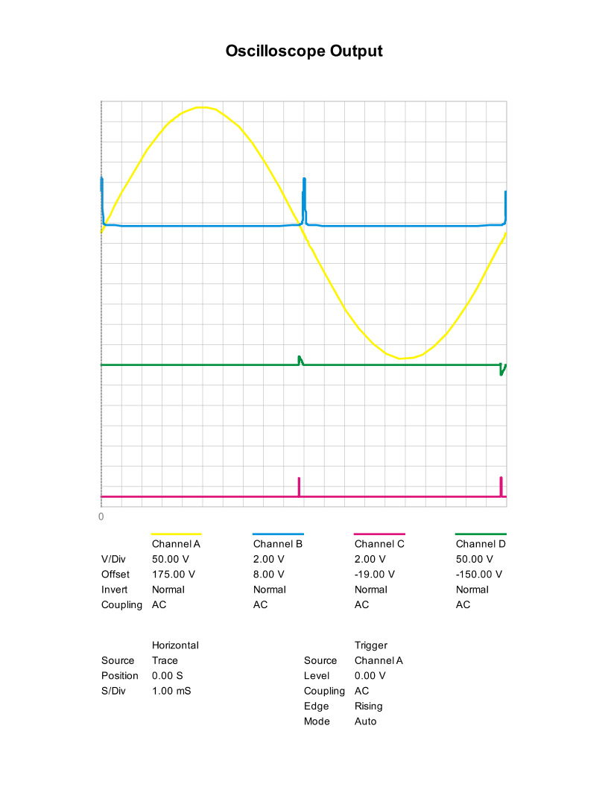
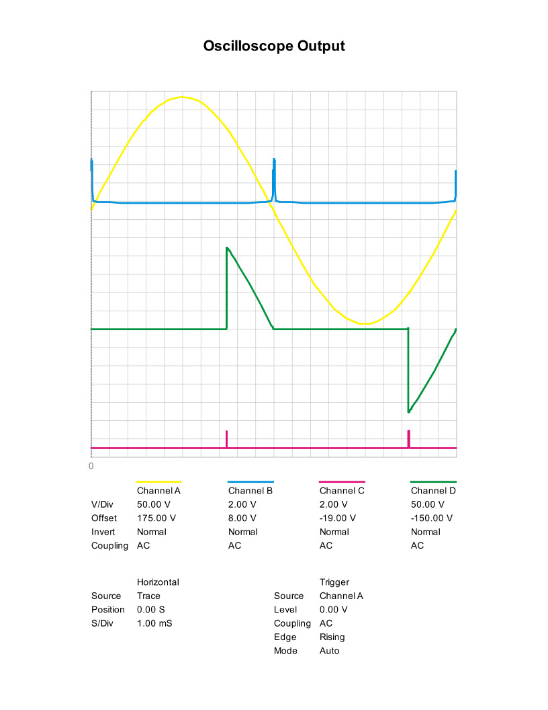
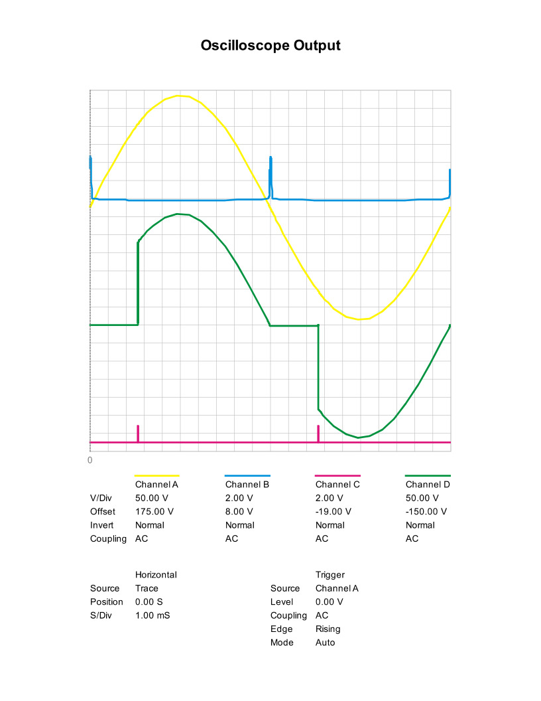
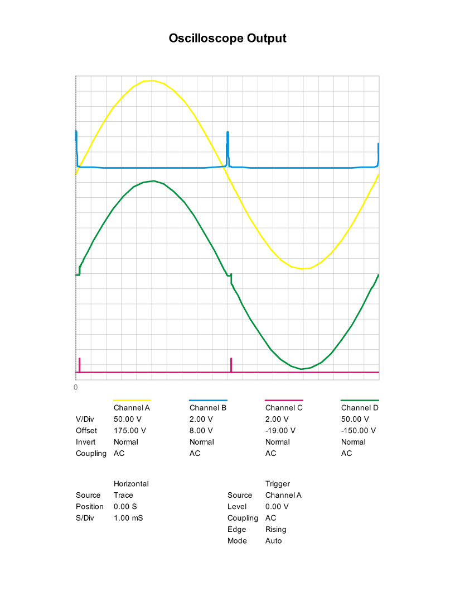
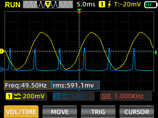
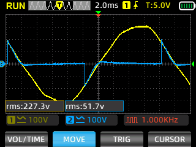
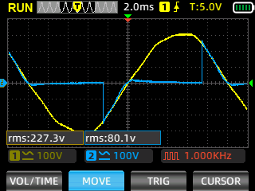
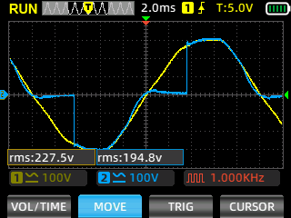
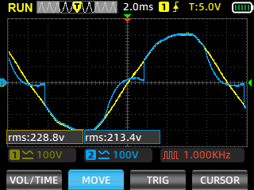

# Oscilloscope Waveforms & Signal Analysis

This document details both Proteus circuit simulation oscilloscope captures and physical hardware oscilloscope measurements for zero-crossing detection and phase-angle TRIAC dimming.

---

## ⚡ 1. Zero-Cross Optocoupler Comparison (`PC817` vs `4N25` vs `H11AA1`)

To achieve precise AC phase dimming, the zero-crossing pulse must trigger exactly when the AC sine wave crosses 0V. The image below compares three optocoupler responses against the AC mains input:

### Channel Color Key:
* 🟡 **Yellow (Channel A)**: AC Mains Voltage Input ($230\text{V}_{\text{RMS}} / 50\text{Hz}$)
* 🔵 **Blue (Channel B)**: **PC817** Response (High propagation delay, wide zero-cross gap due to low CTR at low current)
* 🔴 **Red (Channel C)**: **4N25** Response (Fast switching speed with 47k$\Omega$ input resistor and full-wave bridge rectifier)
* 🟢 **Green (Channel D)**: **H11AA1** Response (Dual-diode AC input optocoupler yielding sharp pulses)

---

## 💻 2. Proteus Simulation Waveforms (Phase Dimming Control)

The following Proteus simulation captures demonstrate AC phase-angle slicing at 0%, 25%, 75%, and 100% brightness levels.

### Channel Color Key:
* 🟡 **Yellow (Channel A)**: AC Mains Line Input
* 🔵 **Blue (Channel B)**: `Zero-Cross` Pulse Output
* 🔴 **Red (Channel C)**: `PWM` MCU TRIAC Gate Trigger Pulse
* 🟢 **Green (Channel D)**: Phase-Cut AC Voltage Output Across Load (`Out`)

---

### Brightness 0% (Fully OFF)

*TRIAC is never triggered; Green output line remains flat (0V).*

---

### Brightness 25%

*TRIAC fires late in the AC half-cycle (~7.5ms delay), conducting a narrow slice of AC power.*

---

### Brightness 75%

*TRIAC fires early in the AC half-cycle (~2.5ms delay), conducting most of the AC energy.*

---

### Brightness 100% (Fully ON)

*TRIAC fires immediately following the zero-cross pulse, conducting full AC power.*

---

### TRIAC Output Waveform Detail

*Detailed view of the phase-cut AC sinusoidal waveform across the load.*

---

## 🔬 3. Physical Hardware Oscilloscope Measurements

Measurements captured from a physical oscilloscope connected directly to the Dimmo circuit board hardware.

### Physical Zero-Crossing Signal (`zc.bmp`)

* 🟡 **Yellow (Channel 1)**: $230\text{V}_{\text{RMS}}$ AC Mains Input Waveform
* 🔵 **Blue (Channel 2)**: Physical `Zero-Cross` Pulse Output ($5\text{V}$ Logic signal pulling LOW on AC zero-crossing)

---

### Physical Hardware Load Output (0% Brightness)

---

### Physical Hardware Load Output (25% Brightness)

---

### Physical Hardware Output (75% Brightness)

---

### Physical Hardware Output (100% Brightness)

### Hardware Signal Channel Key:
* 🟡 **Yellow (Channel 1)**: AC Mains Voltage Input
* 🔵 **Blue (Channel 2)**: Physical AC Dimmed Load Voltage Output (`Out`)
